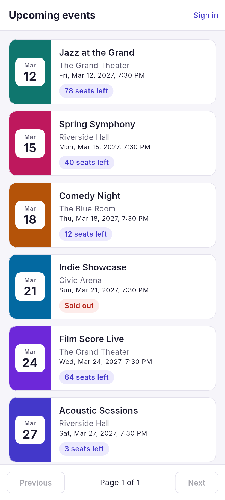
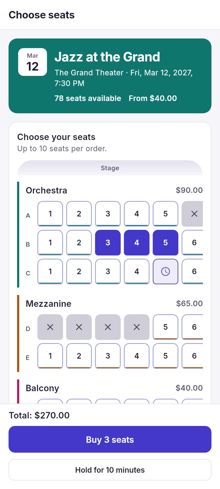
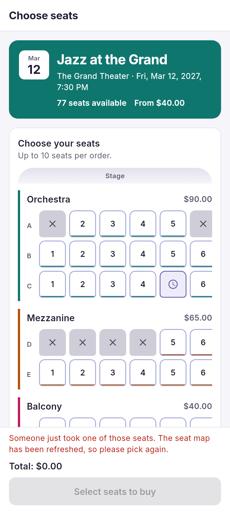
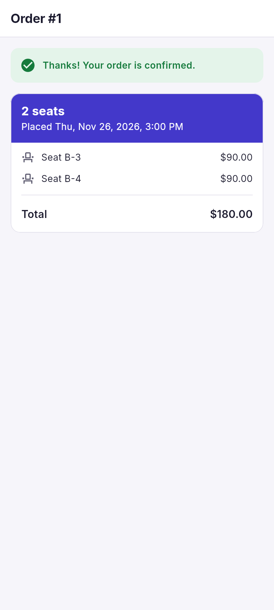

# booking-mobile

[](https://github.com/Kurtis-H/booking-mobile/actions/workflows/ci.yml)

A Flutter (Android) app for buying event seats, built on the booking API from [api-performance-lab](https://github.com/Kurtis-H/api-performance-lab). It does the same job as the web app [booking-web](https://github.com/Kurtis-H/booking-web), and it is the mobile target for the Appium and Maestro side of my test framework comparison.

| Events | Seat map | Seat taken first | Order |
|---|---|---|---|
|  |  |  |  |

These are the app's golden test images, so they always show the current build.

## What it does

* Browse upcoming events a page at a time, with seats left and sold-out events marked.
* Pick up to 10 seats on a seat map, see the total, and buy them (signing in first if needed).
* Hold your seats for 10 minutes while you decide, with a countdown and a Release button. A hold is picked up again when you reopen the event. Seats someone else holds show a clock and can't be picked, and when a hold runs out the app says so.
* Venues are laid out in sections (Orchestra, Mezzanine, Balcony), each a price tier with its own color, as on the website. Rows stay on one line and a wide section scrolls sideways, with the row letters pinned. Sold seats stay in place as darker seats marked with an X (not just a different color), so rows keep their shape.
* See your orders and open any of them.
* Handle what goes wrong on a phone: someone else buys your seat first (409), rate limits (429, using `Retry-After`), an expired session (401), missing events (404), and being offline. Every case has a clear message and a way forward.
* Accessible: each seat is announced as "Seat R2-5, $30.00" with its selected state, and tap targets and text contrast are checked by the tests.

## How it's tested

| Layer | Tool | What it checks |
|---|---|---|
| Unit | `flutter_test` | Seat selection rules, money and date formatting, error messages, the API client (status codes, `Retry-After`, bad bodies, network failures) |
| Widget | `flutter_test` + an in-memory fake API | Every screen through the whole app: paging, buying, losing a seat to another buyer, rate limits, sign-in errors, offline and retry |
| Golden | `matchesGoldenFile`, with the real fonts | Every key screen on a phone-sized view, and the seat map plain and in sections, pixel for pixel. Fixed data (`FakeBackend.showcase`) keeps them stable |
| Accessibility | `meetsGuideline`, semantics matchers | Screen-reader labels and states, 48dp tap targets, WCAG text contrast |
| Integration | `integration_test` on an Android emulator | The real app against the **real** API and Postgres, including a seat sold to someone else mid-purchase |
| End to end | Maestro on the same emulator | Black-box flows a tester would write: buy seats, sign-in errors, the 10-seat limit |
| Release build | `flutter_test` on the Android config, plus CI checks on the release APK | Release builds allow no plain HTTP and keep no backups. CI checks that a release build without a key fails, and that the release APK isn't debug-signed and doesn't contain the demo key |
| Consumer contract | Pact (V4 file format) | What this app needs from the API: 9 interactions checked against the app's own client. The API's CI replays them against the real API |

Unit and widget tests need at least 80% line coverage (`tool/check_coverage.dart`).

The fake API in `test/support/fake_backend.dart` follows the real API's rules (401, 404, 409), so widget tests are fast and offline, while the emulator job proves the app works against the real thing.

Seats carry a semantics `identifier` (`seat-R1-1`), which Android exposes as a resource id, so Maestro and Appium can find them without relying on on-screen text.

## Run it

You need Flutter (stable) and, for the emulator tests, the booking API running on your machine (from api-performance-lab: `scripts/serve.sh`).

```bash
flutter pub get
flutter test                       # unit, widget, golden and accessibility tests
flutter run --dart-define=API_URL=http://10.0.2.2:8000     # Android emulator -> your machine
flutter test integration_test --dart-define=API_URL=http://10.0.2.2:8000
maestro test .maestro              # with the app installed on the emulator
```

Sign in with a key from the seed data (`key-user-1` to `key-user-200`), or tap "Use the demo account" (debug and profile builds only). These keys are public test data.

### Release builds

A release build needs a signing key, and there is no fallback to the debug key. Create one once and keep it out of git (`key.properties`, `*.jks` and `*.keystore` are already ignored):

```bash
keytool -genkeypair -keystore android/app/release.jks -alias release -keyalg RSA -keysize 2048 -validity 10000
cat > android/key.properties <<EOF
storePassword=<the store password>
keyPassword=<the key password>
keyAlias=release
storeFile=release.jks
EOF
flutter build apk --release --dart-define=API_URL=https://<your API>
```

Release builds only talk HTTPS, so `API_URL` must be an `https://` address. Plain HTTP to the emulator host and localhost is allowed in debug and profile builds only.

## CI

Every push and pull request runs:

* **Analyze, unit, widget and golden tests:** `dart format` check, `flutter analyze`, tests with the coverage gate (including the consumer contract, which must match the committed `pacts/` file), and a self-test of the integration-run script with fake `flutter` and `adb` commands
* **Build the Android app:** a debug APK, then the release checks. A release build without a key must fail, and a release APK built with a throwaway key must be signed with that key and must not contain the demo key
* **Integration tests and Maestro on an emulator:** starts Postgres and the booking API, boots an Android 14 emulator, runs `integration_test` through [`tool/run_integration_tests.sh`](tool/run_integration_tests.sh), then installs the APK and runs every Maestro flow
* **CodeQL** for the workflows (CodeQL doesn't analyze Dart), and Dependabot for pub, Gradle and Actions

## How this was built

I wrote this without a local Flutter SDK, so GitHub Actions did the compiling: a one-off bootstrap workflow ran `flutter create` for the Android project, upgraded dependencies, generated the golden image and formatted the code, then committed the results back to the branch. Every later change was checked by CI on the pull request.

## Golden tests

`test/goldens/` compares 8 screens and 2 seat-map states with approved images, rendered with Inter and Material Icons. Flutter tests draw text as blocks by default, which would hide any change to type, so `flutter_test_config.dart` loads the real fonts for that folder. Flutter is pinned (3.50.1) in CI, because goldens are only comparable on one version.

To change the look on purpose, run the CI workflow by hand with "Make new golden screenshots" ticked. It also regenerates the consumer contract, uploads both as an artifact and prints them to the log. Review the images and commit them.

The first goldens of the redesign found a real bug: after someone else took seat A-1, the app hid it, so row A shifted and no longer lined up with the rows behind it. Sold seats are now drawn in place.

## Consumer contract

[`test/contract/booking_api_contract_test.dart`](test/contract/booking_api_contract_test.dart) runs the app's own `BookingApi` against a stub for each call the app makes. It checks the exact request sent (method, path, query, headers, body) and that the response parses, then writes [`pacts/booking-mobile-booking-api.json`](pacts/booking-mobile-booking-api.json). [api-performance-lab](https://github.com/Kurtis-H/api-performance-lab) replays that file against the real API with Pact's official verifier on every API change.

* **Why not a Pact library for Dart?** `pact_dart` pins `http ^0.13` (this app uses `^1.2`), hasn't had a release in 19 months, and can't inject ids from provider states. So [`pact_writer.dart`](test/contract/pact_writer.dart) writes the standard Pact V4 file itself. The official verifier would reject a malformed file, so the API's job checks the format too.
* **Consumer-specific on purpose.** This app shows `#<seat id>` when an order item has no label, so its contract doesn't require `label`. booking-web's does. If the API stopped sending labels, booking-web's contract would fail and this one would pass.
* CI fails if the committed contract is out of date.

## When an emulator run gets stuck

Very rarely (once in 42 CI runs so far), an integration test on the CI emulator hangs instead of failing: [#14](https://github.com/Kurtis-H/booking-mobile/issues/14). So:

* Each integration test marks the step it's on, and a [watchdog](integration_test/support/watchdog.dart) logs a `WATCHDOG:` line to logcat if one step takes over 60 s, with the frame scheduler's state.
* The run script watches logcat for that line. It then saves a screenshot, frame stats, a thread dump and logcat into `diagnostics/` while the emulator is still stuck, prints a summary in the job log, and retries once. A run with a real test failure is never retried.

## Planted bug for test-sensitivity runs

[framework-showdown](https://github.com/Kurtis-H/framework-showdown) needs to prove its suites can fail. Building with `--dart-define=PLANTED_BUG=total` switches on one bug in [`lib/logic/planted_bug.dart`](lib/logic/planted_bug.dart): the order total counts only the first seat. It's off unless set at build time.

## Security

[mobile-security-lab](https://github.com/Kurtis-H/mobile-security-lab) scans every build of the release APK with MobSF and checks its findings. Four are fixed here: release signing (MS-01), plain HTTP in release builds (MS-02), the demo key in the release binary (MS-03) and backups (MS-04). The fifth, support for Android 7 (MS-05), is an accepted risk.

## Known gaps

* Android only for now. Adding iOS means generating the iOS project and running the emulator job on a macOS runner (free for public repos), plus an iOS simulator for Maestro.
